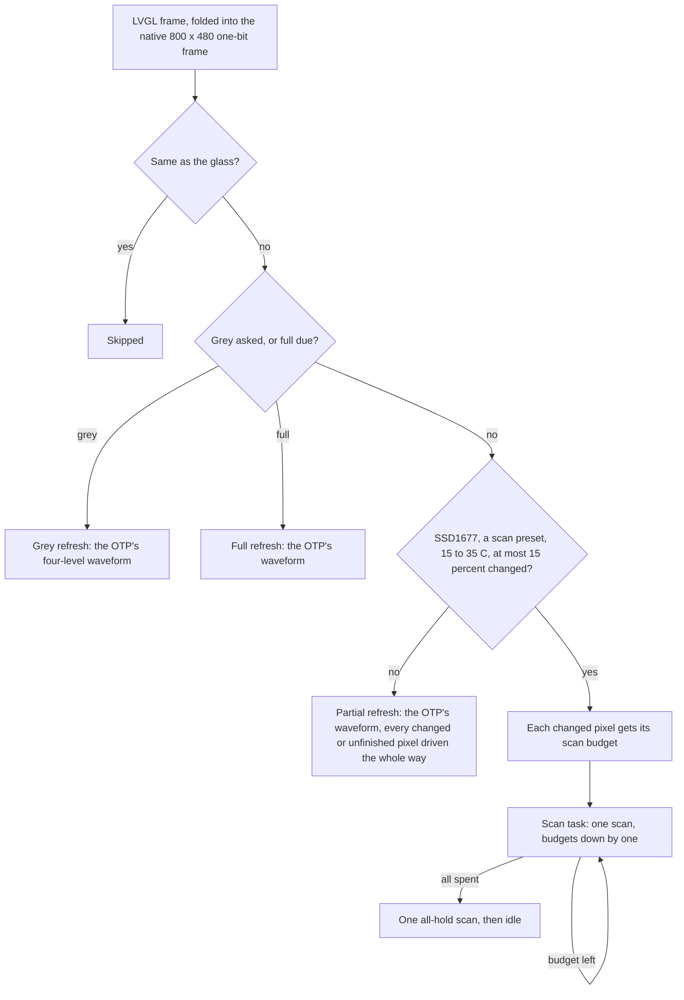

# FolloUp — E-Paper Waveforms

How the reTerminal Sticky's e-paper glass is refreshed on each controller — the SSD1677 of V1.0 and the SSD2677 of
V2.0: the waveforms each runs, our scan method on the SSD1677, the speed presets and their defaults, what each costs on
the board, and the rules that keep the panel safe. People read it before changing how the glass is refreshed; coding
agents read it before they touch a display driver or the refresh policy.

**Source of truth.** The code: the panel interface and the bus in `components/epaper` (`epaper.h`, `epaper_bus.cpp`),
the drivers in `components/ssd1677/ssd1677.cpp` and `components/ssd2677/ssd2677.cpp`, the refresh policy and the
scan engine in `components/lvgl_display/display.cpp`, and the controller's detection in
`components/board/board_display.cpp`. The controllers' datasheets and Seeed's reference driver are the sources of
their command sequences. Related: [STICKY_HARDWARE_SPECS §4.5](STICKY_HARDWARE_SPECS.md#45-display-controllers) —
the two controllers' facts, which this doc does not restate; [STICKY_DESIGN_TOKENS §5](STICKY_DESIGN_TOKENS.md#5-refresh-and-feedback)
— the refresh rules the screens' design depends on. Steps — flashing, the boot check, the benchmark on the board: the
`build-run-test` skill ([.agents/skills/build-run-test/SKILL.md](../.agents/skills/build-run-test/SKILL.md)).

**Stability.** Code comments cite this doc's `§n`. Do not renumber; add new material under the next free number.

| Tag | Meaning |
| --- | --- |
| `[DS]` | From the controller's datasheet — SSD1677 Rev 1.0 (Nov 2018), SSD2677 Rev 1.0 (Mar 2024) |
| `[SRC]` | From Seeed's reference driver for the Sticky (`Seeed-Projects/sticky-esp-idf-peripherals` at `4b7f9a1`), whose sequences our drivers follow command for command |
| `[INK]` | From InkBoy (`github.com/kuslota/InkBoy`), whose scan method our SSD1677 scans adapt |
| `[FW]` | Proven by our firmware running on the board |
| `[MEAS]` | Measured on the board on 2026-11-19 with firmware `folloup` 0.1.0 (commit `4d6da5c` and the working tree), ESP-IDF v6.1 and LVGL 9.5.0 unless a table's note names v6.1.1 and LVGL 9.6.0 for its animation column, on USB power at room temperature — the SHT40 inside 15–35 °C; the benchmark is `hw_test`'s, the median of 30 partial frames per preset |
| `[SEEN]` | Seen on the glass by the person, on the same day and build as `[MEAS]` |
| `[D]` | Derived from the cited values, not measured |
| `[?]` | Unverified — tracked in Open items |

| § | Section | Look here for |
| --- | --- | --- |
| 1 | [The shape](#1-the-shape) | Which refresh a frame gets, and where each runs |
| 2 | [Rules](#2-rules) | What keeps the panel safe and the glass clean |
| 3 | [How it works](#3-how-it-works) | Each controller's waveforms, the scans, the policy, the presets |
| 4 | [Measurements](#4-measurements) | What each refresh costs on a V1.0 and a V2.0 board |
| 5 | [Decisions](#5-decisions) | Why the drivers and the scans are shaped as they are |
| 6 | [Traps](#6-traps) | Symptoms seen on the glass, their causes and fixes |
| 7 | [Open items](#7-open-items) | What is still unmeasured or unproven |

---

## 1. The shape

**Every frame LVGL draws becomes one refresh by the controller's own waveform, or — on the SSD1677, for a small
change — scans of ours that a task of their own runs until every changed pixel has had its whole drive.**

- **The controller is read once, at start** — command `0x70` answers `0x07` on the SSD2677 and nothing on the SSD1677,
  and the board creates that driver behind `epaper::Panel` (`components/board/board_display.cpp`) `[SRC]` `[FW]`.
- **A frame waits for the first scan of its change**, so the glass paces LVGL; the pixels then keep finishing scan
  after scan while the next frames are drawn `[FW]`.

---

## 2. Rules

- **Never send an OTP-programming command** — on the SSD1677 `0x30`, `0x36`, `0x2A` and `0x08`; on the SSD2677 `0x90`
  (OTP program mode) and `0x91` (burn the OTP, with the chip's own programming power) — they change the controller for
  good `[DS]`. The `sticky-hardware` skill's `sticky_check.py otp` reads every command the drivers send: the SSD2677's
  must be Seeed's, the SSD1677's none of its OTP or voltage commands, the shared bus's only the ID probe.
- **Send the SSD2677 only what its datasheet documents or Seeed's driver sends** — the datasheet calls every
  command it does not list reserved `[DS]`. Five of Seeed's sends are undocumented, and kept because the person chose
  Seeed's sequences: `0xA5` sent as a command (the datasheet has `0xA5` only as the check code of deep sleep, `0x07`,
  and a parameter of the auto sequence, `0x17`), `0x62` (eight bytes Seeed calls timing), `0xE7`, `0xE9`, and bit 4
  of `0xE0`, which the datasheet marks 0 `[DS]` `[SRC]`. `0xA5` loads the forced temperature's waveform — without
  it the full refresh drives a partial-length waveform; the other four change no refresh's time (§4.1) `[MEAS]`.
- **Never send UC8179 code to the SSD2677** — the UC8179's partial-window opcodes, `0x90` and `0x91` `[SRC]`, are the
  SSD2677's OTP program and burn `[DS]`; the UC8179 driver is left out of the build `[FW]`. The SSD2677's own partial window
  is `0x83` (PTLW), which every partial uses (§3.1) `[DS]` `[FW]`.
- **Never write the gate, source or VCOM voltages** (`0x03`, `0x04`, `0x2C`) — our waveform runs on the panel's own,
  which the OTP load sets after each reset (`0x22` = `0xB9`) `[DS]` `[FW]`.
- **Give each changed pixel its whole budget in one direction, the two directions equal and opposite** — a pixel that
  goes and comes back nets no charge; an unbalanced drive can leave a ghost image in the panel for good `[INK]` `[DS]`.
- **Run scans only between 15 and 35 °C by the SHT40** — one fixed waveform does not suit every temperature; outside the
  window the OTP's partial waveform runs `[FW]`.
- **Draw every full refresh with the OTP's waveform** — the scans' waveform is for partials only `[FW]`.
- **Keep the full refresh after 20 partials by the OTP's waveform, and after 150 scan frames at the next pause of 2 s**
  — ghosting builds up over many partials, and a full refresh mid-motion would interrupt it
  ([STICKY_DESIGN_TOKENS §5](STICKY_DESIGN_TOKENS.md#5-refresh-and-feedback)) `[FW]`.
- **Read the panel at 2 MHz and write it at 20 MHz** — the SSD2677 reads at 2.5 MHz at most and both controllers write
  at 20 MHz at most; the ID probe is the only read once the SHT40 gives the temperature (`kPanelReadHz`,
  `kPanelWriteHz` in `components/board_config/include/board_config.h`) `[DS]` `[FW]`.

---

## 3. How it works

**Each controller refreshes with waveforms stored in its OTP; the SSD1677 can also run a waveform we load, which our
scans use.**

### 3.1 The SSD2677 (V2.0)

**The OTP holds the waveforms; the firmware picks one by a forced temperature and may fix the frame rate of a partial.**

- **No waveform can be loaded** — no command writes waveform data; the OTP holds them. PSR's (`0x00`) second byte,
  bit 7, `LUT_EN`: 0 loads the LUT from the OTP at reset and the analog settings follow it, 1 skips the load. Seeed's
  `0x0E` leaves it 0 `[DS]` `[SRC]`.
- **A waveform is picked by forcing the temperature** — `0xE0` (CCSET) bit 1, `TSFIX`, takes the temperature from
  `0xE6` (TS_SET) instead of the internal sensor; TS_SET is a signed byte, 1 °C a step, from `0xE7` (−25 °C) to `0x32`
  (50 °C) `[DS]`. Seeed sends `0xE0` = `0x12` (TSFIX, and bit 4, which the datasheet marks 0), then `0xE6`, then
  `0xA5` as a command, which the datasheet does not list (§2) `[SRC]` — and the forced temperature's waveform loads
  only with `0xA5` (§4.1) `[MEAS]`.
- **Seeed's forced temperatures, by the room's** — full −24, −21, −18 or −15 °C (`0xE8`, `0xEB`, `0xEE`, `0xF1`);
  partial 8, 15, 25 or 35 °C (`0x08`, `0x0F`, `0x19`, `0x23`); grey −15 or −6 °C (`0xF1`, `0xFA`) `[SRC]` `[D]`. The
  full and grey waveforms sit in the cold bands, so the OTP keeps its other waveforms there `[D]`; what each band holds
  is the panel maker's programming, which no public document gives `[?]`.
- **The temperature is the SHT40's**, given at start and again about once a minute while the glass is idle
  (`kTemperatureEveryMs`, `lvgl_display::SetTemperatureSource`); the controller's own sensor (`0x40`) is read only
  when no SHT40 reading has been given `[FW]`.
- **The controller stays powered between refreshes** — it powers off after a greyscale refresh, as Seeed's does, and
  before deep sleep. Its power-off (`0x02`)
  lets black fade within seconds of a refresh; with the supply left on, black holds. PSR's ground ties do not change
  it: NORG off, NORG and TIEG off, and FOPT = `01` all still faded `[SEEN]`. The cost is the supply's idle current,
  unmeasured (§7) `[FW]`.
- **A slot is latched only when it changes** — not before every refresh `[FW]`.
- **The controller is reset and initialised once**, and again only after deep sleep or a failed drive — a refresh
  or a standby (§6); a change of mode is a new latch alone `[FW]`.
- **A partial may run at a fixed frame rate** — `0x30`'s `FR[2:0]`: `0x00` 12.5 Hz, `0x01` 25 Hz, `0x02` 50 Hz (the
  power-on value), `0x03` 65 Hz, `0x04` 75 Hz, `0x05` 85 Hz; bit 3 enables a dynamic frame rate `[DS]`. Seeed
  initialises `0x08` — the dynamic rate on — and the "Waveform rate" preset keeps it `[SRC]`.
- **A partial streams only the box of changed pixels, through the partial window** — `0x83` (PTLW) sets the box and
  partial mode, a full or grey refresh turns partial mode off, and a reset clears it. Source addresses run right to
  left, as the rows stream. The gates still scan the whole glass, so the drive takes as long and only the upload
  shrinks: 4–8 ms against 39 for the benchmark's bar `[DS]` `[MEAS]`. Partial mode drives the box alone, so the
  memory outside it never shows — the window drew cleanly on the glass `[SEEN]`.
- **The frame goes out as two bits a pixel, each row right to left** — the controller does not mirror X; full is the
  frame widened (white `11`, black `00`), partial is old and new interleaved, grey is the four levels `[SRC]`.

Where it lives: `components/ssd2677/ssd2677.cpp`.

### 3.2 The SSD1677 (V1.0) — the OTP's waveforms

**Full, partial and grey refreshes run the OTP's waveforms in Seeed's sequences; a partial may keep the waveform it
loaded.**

- **Full** — `0x22` = `0xF4`, which loads the temperature and the waveform and leaves the clock and the drive's supply
  on `[SRC]`.
- **Partial** — old frame to `0x26`, new to `0x24`, `0x21` = `00 00`, then `0x22` = `0xFC` — `0xFF`, which also turns the
  clock and the drive's supply off after, for every partial from a standby until the controller is set up again, as
  Seeed's driver does (`partial_after_standby`) `[SRC]`.
- **Kept waveform** — a later partial drives with `0x22` = `0xCC`, loading neither the temperature nor the waveform
  `[FW]`.
- **Grey** — the two bits a pixel split into two planes, `0x1A` = `67 00` (a forced 103 °C), then `0x22` = `0xD7` `[SRC]`.
- **The controller mirrors X itself** — data entry `0x02` and a RAM X window from 799 down — so frames go in as given
  `[SRC]`.

Where it lives: `components/ssd1677/ssd1677.cpp` — `Full`, `Partial`, `Gray`, `PartialSequence`.

### 3.3 The SSD1677 scans

**The two RAM planes hold masks, not images, and each scan runs a few frames of our own waveform: the pixels set in
`0x26` move toward black, those set in `0x24` toward white, and the rest hold** `[INK]` `[FW]`.

| LUT | `0x26`, `0x24` | Drive | Phase A of group 0 |
| --- | --- | --- | --- |
| LUT0 | 0, 0 | Hold | VSS |
| LUT1 | 0, 1 | Toward white | VSL — LUT byte 10 = `0x80` |
| LUT2 | 1, 0 | Toward black | VSH1 — LUT byte 20 = `0x40` |
| LUT3 | 1, 1 | Hold — never sent | VSS |
| LUT4 | — | VCOM | DC |

- **The waveform is 105 bytes written with `0x32`** — bytes 0–49 the five LUTs' phases, two bits each (`00` VSS, `01`
  VSH1, `10` VSL); 50–99 each group's four phase lengths in frames and its repeat; 100–104 the frame rate `[DS]`.
- **One phase drives** — TP[0A] (byte 50) is the scan's frames, every other phase is 0 and so skipped, the group runs
  once; the frame-rate bytes are `0x44`, about 10 ms a frame on this glass `[FW]` `[MEAS]`.
- **The OTP's waveform and voltages load first** — after each reset, `0x22` = `0xB9`, then our table replaces bytes
  0–104 only `[DS]` `[FW]`.
- **A scan is the display step alone** — the clock and the drive's supply are turned on once (`0x22` = `0xC0`) and each
  scan sends `0x22` = `0x0C`; `0xCC` on every scan re-enabled them and cost about 80 ms a scan `[INK]` `[MEAS]`.
- **Only the rows and byte columns in play are uploaded**, joined with the last scan's, so the last masks are cleared to
  hold; after an image refresh the whole RAM is rewritten `[FW]`.
- **Each changed pixel gets a budget of scans toward its new colour** — a counter in four bit-planes; each scan drives
  every pixel with budget left and counts it down; a pixel that changes again before it finishes starts a fresh budget
  the new way `[INK]` `[FW]`.
- **Scans run in a task of their own**, below LVGL's priority, and step aside after each scan while a frame waits for
  the engine — so new changes start while earlier ones finish `[FW]`.
- **The scans end with one all-hold scan** — every mask clear — after the last budget is spent `[INK]` `[FW]`.

Where it lives: `components/ssd1677/ssd1677.cpp` — `Scan`, `DoScan`, `LoadScanWaveform`; the budgets and the task in
`components/lvgl_display/display.cpp` — `StartScans`, `ScanOnce`, `ScanTask`.

### 3.4 Which refresh a frame gets

**A frame is skipped, scanned, or drawn by the OTP's waveform, by the rules below, in this order — the skip applies to
a partial only, so a full or grey refresh is drawn even when the frame is the glass already.**

| When | Refresh | Where it is set |
| --- | --- | --- |
| A partial whose frame is the glass already | None — skipped | `Send` |
| Grey asked for | Grey, by the OTP | `RequestGray` |
| The first frame, a full asked for, or 20 partials by the OTP since the last full | Full, by the OTP — no ghost seen before it on either board, the SSD2677's over a day of page changes, drags and scrolls on a V2.0 `[SEEN]` | `kRefreshPartialLimit` (`design_tokens.h`) |
| A full or grey asked for sooner after the last full or grey ended than that one took | The same refresh, after waiting out the rest of that time — never two back to back, never dropped | `WaitAfterFlash` in `Send` |
| A partial, or a new screen's first pass, that fails — a recovery, after the attempt | Full, by the OTP, from a reset, in the same frame, without the back-to-back wait; after a failed full or grey, the next frame is full | `Send` |
| A new screen on the SSD1677 | Two partials by the OTP — every pixel to white, then the screen — counted as two, so one that would pass 20 is drawn full instead; never scans. One partial left the old page's ghost on the glass `[SEEN]` | `s_page_changed`, set by LVGL's `LV_EVENT_SCREEN_LOADED` |
| SSD1677, a scan preset, 15–35 °C, at most 15 % of the pixels changed | Scans | `kScanMaxChanged` |
| Anything else | Partial, by the OTP — after scans, the changed pixels and any still part-way driven the whole way (`Settle`) | `Send` |
| 150 frames by scans since the last full, then 2 s with nothing drawn | Full, by the OTP | `kScanFramesBeforeFull`, `kFullAfterPauseMs` |
| 1 s with nothing drawn and no scan pending | Standby — on the SSD1677 the drive's supply off, nothing driven when a `0xFF` partial left it off already; the SSD2677 stays powered | `kStandbyAfterMs` |

Where it lives: `components/lvgl_display/display.cpp`.

### 3.5 Presets and defaults

**Each controller has its own presets; the first is Seeed's, and the default is the one the glass was judged by.**

| Controller | Preset | What it sets | Default |
| --- | --- | --- | --- |
| SSD2677 | Waveform rate | Seeed's: the waveform's own rate (`0x30` = `0x08`) | |
| SSD2677 | 75 Hz | `0x30` = `0x04` for partials | |
| SSD2677 | 85 Hz | `0x30` = `0x05` for partials | Yes — the fastest, no ghosting `[SEEN]` |
| SSD1677 | Seeed | `0xFC` on every partial | |
| SSD1677 | Keep waveform | `0xCC` after the first partial | |
| SSD1677 | Scan 2 x 12 | Scans of 2 frames, a budget of 12 | Yes — the person's choice `[SEEN]` |
| SSD1677 | Scan 3 x 10 | Scans of 3 frames, a budget of 10 | |
| SSD1677 | Scan 4 x 10 | Scans of 4 frames, a budget of 10 | |

- **A preset is chosen on the board** — the Display screen's Speed button, or `speed <n>` on the console `[FW]`.
- **Each driver refuses a value off its allow-list** — the SSD2677's frame rate `0x02`–`0x05` or `0x08`; the SSD1677's
  scans 1–8 frames and a budget of 2–15 `[FW]`.

Where it lives: `kTunings2677`, `kTunings1677` in `components/lvgl_display/display.cpp`; `SetTuning` in each driver.

---

## 4. Measurements

**Times are per refresh, from the call to the panel's return, and per frame of the benchmark's animation — a black bar
growing and shrinking by 36 px a frame on a white track** `[MEAS]`.

### 4.1 The V2.0 board (SSD2677)

| Refresh | Total | Drive | Frame of the animation | Source |
| --- | --- | --- | --- | --- |
| Full | 1007–1050 ms | 876 ms | — | `[MEAS]` |
| Partial, waveform rate | 429 ms | 416 ms | 458 ms, 2.18 fps | `[MEAS]` |
| Partial, 75 Hz | 433 ms | 416 ms | 456 ms, 2.19 fps | `[MEAS]` |
| Partial, 85 Hz | 381 ms | 369 ms | 408 ms, 2.45 fps | `[MEAS]` |
| Partial, 65 Hz | — | 462 ms | 677 ms | `[?]` — measured on Seeed's driver |
| Partial, a forced 35 °C or 50 °C slot | — | 404 ms | 621 ms — no change | `[?]` — measured on Seeed's driver |
| Grey | 1237–1253 ms | 1036–1052 ms | — | `[MEAS]` on 2026-11-20 (commit `e44bcc8` and the working tree, ESP-IDF v6.1.1, LVGL 9.6.0) — Seeed's driver took 1759 ms |

- **The measured rows, and the table below, are on ESP-IDF v6.1.1 and LVGL 9.6.0, the partials through the partial
  window**; the `[?]` rows are Seeed's driver. With the whole frame streamed, the animation gave 489, 488 and 440 ms a
  frame; on LVGL 9.5.0, 481, 481 and 432 ms `[MEAS]`.
- **Seeed's undocumented sends, each left out in turn** — the drive's time with all of them, then without each, on
  ESP-IDF v6.1.1 and LVGL 9.6.0 `[MEAS]`:

  | Left out | Full, drive | Partial, drive | Frame at 85 Hz |
  | --- | --- | --- | --- |
  | None — Seeed's sequence, the whole frame streamed | 876 ms | 416 ms | 439 ms |
  | `0xA5` | 406 ms | 405 ms | 428 ms |
  | `0x62`, `0xE7`, `0xE9` or `0xE0`'s bit 4, each alone | 875–876 ms | 416 ms | 440 ms |

- **A whole frame goes out in 39 ms** — 96000 bytes at 20 MHz, encoded while the last chunk sends `[MEAS]`.
- **A drive after a standby adds 83 ms** to power the supply on `[MEAS]`.

### 4.2 The V1.0 board (SSD1677)

| Refresh | Total | Drive | Frame of the animation | Source |
| --- | --- | --- | --- | --- |
| Full | 1572–1579 ms | 1508 ms | — | `[MEAS]` |
| Partial, Seeed | 512–519 ms | 470–471 ms | 543 ms, 1.84 fps | `[MEAS]` |
| Partial, kept waveform | 508–515 ms | 467 ms | 541 ms, 1.84 fps | `[MEAS]` |
| A new screen, two partials through white | 1024–1250 ms: median 1026 ms over 15 changes in use, 1248 ms over 73 changes each after a standby (`0xFF` both passes), ESP-IDF v6.1.1 and LVGL 9.6.0 | — | — | `[MEAS]` |
| Partial, a forced 50 °C or 70 °C (`0x1A`) | — | 467 ms | — | `[MEAS]` |
| Partial, a forced 90 °C | — | 1505 ms | — | `[MEAS]` |
| Scans 2 x 12 | 27–39 ms a scan | 19–20 ms | 85 ms, 11.8 fps | `[MEAS]` |
| Scans 3 x 10 | — | — | 100 ms, 10.0 fps | `[MEAS]` |
| Scans 4 x 10 | — | — | 124 ms, 8.1 fps | `[MEAS]` |

- **The animation column is on ESP-IDF v6.1.1 and LVGL 9.6.0**, measured three times. The same firmware on LVGL
  9.5.0 gave 80, 99 and 119 ms for the scans: LVGL 9.6.0 adds 1–5 ms a frame (5 ms on scans 2 x 12 and 4 x 10), and the person keeps 9.6 for the
  newer LVGL `[MEAS]`.

- **The OTP holds one partial waveform from room temperature to 70 °C** — a forced temperature found nothing faster
  `[MEAS]`.
- **A scan's drive is about 10 ms a frame** — 2 frames 19–20 ms, 7 frames 69 ms `[MEAS]`.
- **A scan's upload is 0–10 ms** — only the rows and columns in play `[MEAS]`.
- **A pixel finishes in about 12 scans at 2 x 12** — about 0.35 s `[D]`.
- **The scans draw clean frames: no earlier position of the bar stays on the glass** `[SEEN]`.

---

## 5. Decisions

| Decision | Why | Alternatives that don't work, and why |
| --- | --- | --- |
| Our own drivers, `ssd1677` and `ssd2677`, behind one `epaper::Panel` | One image runs on both revisions; Seeed's sequences are kept command for command while the plumbing is ours | Seeed's driver as vendored — its frame took 113–124 ms to send against our 39 ms on a V2.0 board `[MEAS]`; its core reset the controller on every change of mode and compiled the UC8179 driver, whose opcodes burn the SSD2677's OTP `[SRC]` `[DS]` |
| A new screen on the SSD1677 drawn in two partials, through white | The old page leaves no ghost, and the glass does not flash black as a full refresh does `[SEEN]` | One partial — the old page's ghost stays until the next full refresh `[SEEN]`; a full refresh for every new screen — clean, but about 1.6 s and a black flash each time `[MEAS]` |
| Scans on the SSD1677, InkBoy's method | A change shows within one scan and every pixel still gets a full drive: 11.8 fps against 1.84 `[MEAS]` | One short pulse per frame — the pulse is all the drive a pixel gets, so a pixel that has not finished is never driven again; a forced temperature — the OTP holds no faster partial waveform (§4.2) |
| No scans on the SSD2677 | Its datasheet documents no command to load a waveform; its undocumented commands include OTP programming `[DS]`. A frame rate and the partial window are its levers: 85 Hz is about 1.1 times faster than the waveform's own rate, 408 ms a frame against 458 (§4.1) `[D]` | Scans as on the SSD1677 — no command loads a waveform; a forced hotter temperature — no faster partial on Seeed's driver (§4.1) `[?]` |
| A budget in one direction per change, equal both ways | No net charge on a pixel that goes and comes back | Pushing unchanged pixels to re-saturate them — always the same direction, so charge builds |
| Scans only for changes of at most 15 % of the pixels | A new screen is drawn the whole way at once by the OTP's waveform | Scans for everything — a whole screen's change would need the same 12 scans with nothing to gain |
| The full refresh after 150 scan frames waits for a 2 s pause | Motion is never interrupted by a full refresh — about 1.6 s on a V1.0 board `[D]` | The 20-partials rule counted per scan frame — a full refresh every 2 s of animation `[D]` |

---

## 6. Traps

- **The scanned area shows the inverse of the frame — where a moving bar is now stays white, where it was turns black,
  and changing text shows white on black** → the scan waveform's polarity is reversed: on this glass VSL drives white
  and VSH1 black, the opposite of the Xteink X4 table's sense → LUT1 at VSL, LUT2 at VSH1 (§3.3) `[SEEN]`.
- **Frames stall until the last scan of a change is done, about 450 ms a frame** → the scan task takes the engine back
  the instant it releases it, and lowering its priority below LVGL's did not help — the two tasks are not pinned, and a
  task the scheduler runs on the other core can win the lock before the woken frame does `[MEAS]` `[D]` → the scan task
  steps aside after each scan while a frame waits (`s_frame_waiting`), which brought a frame to 80–85 ms (§4.2) `[MEAS]`.
- **Every scan or quick drive costs about 80 ms more than its frames** → `0x22` = `0xCC` re-enables the clock and the
  drive's supply each time → turn them on once and drive with `0x0C` `[MEAS]`.
- **Pixels outside a scan's area move on a later scan** → a windowed upload leaves the last masks in RAM → upload the
  union of this scan's area and the last one's (§3.3) `[FW]`.
- **The V1.0 freezes for 8 s at a time when left on a page, touch and buttons dead** → a partial drawn with `0xFF`
  turns the clock and the drive's supply off at its end, and `0x03` driven again with the clock off holds BUSY until
  the 8 s timeout — a standby that does so, retried on LVGL's task, freezes the input `[MEAS]` → standby drives nothing
  when the supply is already off, and a failed standby is not retried: the next refresh resets the controller and is
  drawn full `[FW]`.
- **The V2.0's black fades a few seconds after a refresh** → the idle standby's power-off (`0x02`), Seeed's step too
  — with standby off, black held on the glass `[SEEN]` → the SSD2677 stays powered between refreshes (§3.1) `[FW]`.
- **The board's screenshot is clean but the glass is not** → `tests/bench/screenshot.py` sends the frame the firmware
  asked for, not the ink → judge the glass by eye or photograph `[FW]`.

---

## 7. Open items

| Item | Status | Unblocked by |
| --- | --- | --- |
| Whether one short pulse a frame, with the polarity now known, clears as well as the scans — the single-pulse and kick-and-drive presets were tried with the polarity reversed | Open | A single-pulse preset at the corrected polarity, judged on a V1.0 board's glass |
| The SSD1677 grey refresh's time | Open | The Display screen's Four greys, timed on a V1.0 board |
| Whether the SSD2677's glass needs `0x62`, `0xE7`, `0xE9` and `0xE0`'s bit 4 — none changes a refresh's time (§4.1) | Open | A build without each on a V2.0 board, the full and partial refreshes judged on the glass |
| What each of the SSD2677's OTP temperature bands holds — `0x92` (ROTP) reads its 6144 bytes, the same twice over, in a layout no public document gives `[MEAS]` | Open | The module's spec from Seeed, to read the dump by |
| The SSD2677's idle current with its supply left on between refreshes, against a standby — the battery cost of keeping black from fading (§3.1) | Deferred — until the application is complete (the person's choice) | The fuel gauge's current read on battery, idle on a V2.0 running the application, powered and in standby |
| The SSD2677 at 65 Hz on our driver — measured slower than its own rate on Seeed's driver (§4.1) | Open | The benchmark with a 65 Hz preset on a V2.0 board |
| Whether a forced hotter slot changes the SSD2677's partial on our driver — no change on Seeed's driver (§4.1) | Open | The benchmark with a forced 35 °C and 50 °C partial slot on a V2.0 board |
| Ghosting after many scan frames before the full refresh at 150 | Open | A long animation on a V1.0 board, then the glass checked before the full refresh |
| The scans below 15 °C and above 35 °C — the window is a guess, not a measurement | Open | The scans judged on the glass in the cold and the heat |
| The panel's life under scans | Open | A long run on a V1.0 board, the glass checked against a fresh full refresh |
