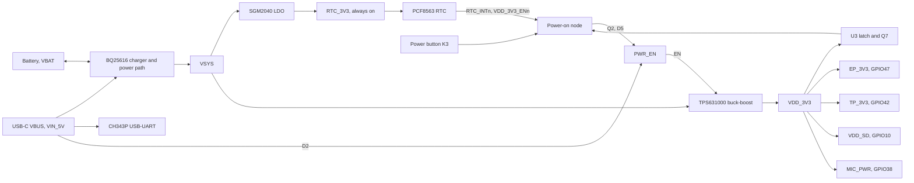

# FolloUp — Hardware Specs

The reTerminal Sticky as firmware sees it: what breaks the hardware or the boot when crossed, the chip and its memory,
the console, the e-paper panel, every pin the code uses, the buses and the devices on them, the power path and the
latch that holds it, sleep and wake, the order the board comes up in, and the enclosure and its controls. People read
it before wiring a driver or picking a pin; coding agents read it before they generate or change the firmware.

**Source of truth.** Seeed's schematic, Rev 01 of 2026-06-05
([STICKY_assets/schematic](../STICKY_assets/schematic/reTerminal_Sticky_Schematic_diagram_260609.pdf)), Seeed's
device guide for the reTerminal Sticky (its hardware overview and example pages), Seeed's ESP-IDF demo source, and
the parts' datasheets. The schematic wins over the device guide for wiring; where either disagrees with what the board
does, the board wins, and the disagreement is an open item (§10). Related:
[the hardware block diagram](../STICKY_assets/images/reTerminal_Sticky_Hardware_Diagram.png),
[the 3D model](https://files.seeedstudio.com/wiki/reterminal_sticky/res/reTerminal_Sticky_3D.stp) (STEP, 27 MB — kept out of git; a local copy goes in `STICKY_assets/drawings/`), and
[ESP_IDF_SETUP](../.agents/skills/esp-idf-setup/references/esp-idf.md) — how a firmware project is generated from
this spec. Steps — bring-up, display work, sleep and power-off, the pin check: the `sticky-hardware` skill
([.agents/skills/sticky-hardware/SKILL.md](../.agents/skills/sticky-hardware/SKILL.md)).

**Stability.** Code comments cite this doc's `§n`. Do not renumber; add new material under the next free number. A
value changes here first, then in `components/board_config` — never only in code. The `esp-idf-setup` skill reads the
Firmware facts and Pins tables by their rows, wherever they sit.

| Tag | Meaning |
| --- | --- |
| `[SCH]` | From Seeed's schematic, Rev 01 — a reference designator (R46, U3) names the part |
| `[DOC]` | From Seeed's device guide for the reTerminal Sticky — the hardware overview and its example pages |
| `[SRC]` | From Seeed's ESP-IDF demo source — `Seeed-Projects/sticky-esp-idf-peripherals` at `4b7f9a1` and `Seeed-Projects/sticky-esp-idf-dashboard` at `1a28b2a` — whose `seeed_epaper` component drives both controllers |
| `[TEAM]` | From the product team — the hardware revisions and what each carries |
| `[DS]` | From a part's datasheet |
| `[FW]` | A value, level or timing proven by firmware running on the board |
| `[MEAS]` | Measured or observed on the board during firmware bring-up; the date and build were not recorded |
| `[D]` | Derived from the cited values, not measured |
| `[?]` | Unverified — tracked in Open items |

| § | Section | Look here for |
| --- | --- | --- |
| 1 | [Critical constraints](#1-critical-constraints) | What breaks the hardware, the boot or the bus when crossed |
| 2 | [Firmware facts](#2-firmware-facts) | The chip, its flash and PSRAM, the console, the panel, the battery |
| 3 | [Pins](#3-pins) | Every signal the firmware drives or reads, by GPIO, with its pulls |
| 4 | [Buses and devices](#4-buses-and-devices) | The buses, each device's address and settings, display timing, the parts list, the two display controllers side by side |
| 5 | [Power](#5-power) | The rails, the charger, the power latch, power-on and power-off, USB sensing |
| 6 | [Sleep and wake](#6-sleep-and-wake) | Wake sources, what light sleep and soft-off need from the pins |
| 7 | [Bring-up order](#7-bring-up-order) | Rails, buses and devices, in the order they come up |
| 8 | [Traps](#8-traps) | Symptoms, their causes and their fixes |
| 9 | [Enclosure and controls](#9-enclosure-and-controls) | Size, weight, mounting, where each button, port and opening sits |
| 10 | [Open items](#10-open-items) | What is still unverified, and what settles it |

---

## 1. Critical constraints

**What breaks the hardware, the boot, the bus or the power path when crossed.**

### 1.1 Pins and boot

- **Every GPIO is taken** — GPIO0–21 and GPIO38–48 carry the board's signals (§3), and the ESP32-S3R8's QSPI flash
  takes GPIO26–32 and its octal PSRAM GPIO33–37 `[SCH]` `[DS]`; a new signal needs a pin given up or an I/O expander
  `[D]`.
- **Strapping pins carry live signals: GPIO0 (sensor I2C SCL), GPIO3 (touch I2C SDA), GPIO45 (`PWR_HOLD`) and GPIO46
  (`PWR_LOCK`)** — GPIO0 low at reset enters download mode with GPIO46 low, GPIO45 sets the VDD_SPI voltage (low for
  the 3.3 V flash) and GPIO3 the JTAG source; add no pull to these pins and drive none before boot completes `[DS]`.
- **There is no BOOT button** — GPIO0's 2 kΩ pull-up (R58) boots the chip from flash, and only the CH343P's
  auto-download transistors (Q3, Q4) put it in download mode, so flashing needs a data cable `[SCH]`.
- **Create the sensor I2C bus only after boot** — GPIO0 is its SCL and a boot-mode strap `[DS]`.
- **GPIO19 and GPIO20 are the ESP32-S3's native USB D− and D+, and this board uses them for the PDM microphone** —
  the USB-C data lines go to the CH343P only, so native USB Serial/JTAG and USB OTG are not available and the console
  is UART0 (§2) `[SCH]` `[DS]`.
- **GPIO39–42 are the ESP32-S3's JTAG pins, and this board uses them for the charger and the touch panel** — external
  JTAG debugging takes them from their signals `[SCH]` `[DS]`.

### 1.2 Shared SPI bus and display

- **The e-paper panel and the MicroSD card share one SPI bus (`SPI2_HOST`)** — every device on it holds one shared
  bus lock for a whole transaction; an SD transaction inside a panel refresh corrupts the refresh `[MEAS]` (§8).
- **With a card inserted, bring the MicroSD card up before the panel and keep it mounted** — the card must enter SPI
  mode before the panel's traffic starts on the shared bus `[MEAS]`.
- **One firmware image drives both display controllers** — V1.0 carries the SSD1677 and V2.0 the SSD2677, so the
  firmware tells them apart at start-up and keeps a driver for each, never a build per revision; a V1.0 board keeps
  working with every release `[TEAM]`. The two share no command set (§4.5), so one driver cannot serve both `[SRC]`.
- **Tell the controllers apart by their ID** — reset with the SSD2677's timing (20 ms low, 10 ms high), send `0x70`,
  read one byte back: `0x07` is the SSD2677, any other value the SSD1677; a failed read is an error, never a fallback
  to either `[SRC]`.
- **Set `EP_BUSY`'s polarity after detection** — the SSD1677 holds BUSY high while busy, the SSD2677 holds it low; a
  wait with the wrong level returns at once or times out `[SRC]`.
- **Set every unused data pin in `spi_bus_config_t` to `-1`** — a field left at 0 assigns GPIO0, the sensor I2C SCL,
  to the SPI bus, and the sensors fail once the display starts `[SRC]` `[DOC]`.
- **Initialise `SPI2_HOST` once, at board start-up, and never free it** — the panel and the card each add and remove
  only their own device; a second `spi_bus_initialize()` or a `spi_bus_free()` from either breaks the other `[SRC]`.
- **The SSD1677 drives its whole area on every refresh** — its RAM window registers (`0x44`, `0x45`) scope where
  writes land, not what is driven, so whatever the RAM holds outside a window is driven too `[MEAS]`: an image refresh
  writes both RAM planes (`0x24`, `0x26`) in full, and a scan clears the last scan's masks with its own window
  ([STICKY_EPAPER_WAVEFORMS §3.3](STICKY_EPAPER_WAVEFORMS.md#33-the-ssd1677-scans)). The SSD2677 is sent the whole
  frame for a full or grey refresh, and for a partial only the box of changed pixels, through its partial window,
  whose partial mode drives the box alone
  ([STICKY_EPAPER_WAVEFORMS §3.1](STICKY_EPAPER_WAVEFORMS.md#31-the-ssd2677-v20)) `[SRC]` `[FW]`.

### 1.3 Power, sensors and touch

- **`GPIO7` carries two interrupts, the IMU's `INT1` and the BQ27220's `GPOUT`** — one owner attaches its ISR and asks
  both devices which fired `[SCH]`.
- **Clear the PCF8563's alarm and timer flags before a power-off** — `RTC_INTn` is the net `VDD_3V3_ENn` on the
  power-on node, so an asserted RTC interrupt holds or turns on the 3.3 V rail `[SCH]` `[?]` (§5.2, §5.3).
- **Keep `PWR_HOLD` and `PWR_LOCK` driven high through light sleep** — on battery the board stays powered only while
  the latch holds `[MEAS]` (§6).
- **Divide the BQ27220's current and capacity by 10, and never reprogram the gauge** — R46 is 100 mΩ `[SCH]`, ten
  times the gauge's default sense resistor `[DS]` `[D]`; the stock profile shows as `DesignCapacity` (`0x3C`) reading
  7500, and percentage and voltage need no scaling `[SRC]`.
- **Leave the touch pins low or floating while `TP_3V3` is off** — their pull-ups (§3.2) go to `TP_3V3`, so a pin
  driven high back-powers the panel through them `[SCH]` `[D]`.

---

## 2. Firmware facts

**The facts the firmware is generated from — one row each, the value alone in its cell.**

| Fact | Value | Source |
| --- | --- | --- |
| Chip | ESP32-S3 | `[SCH]` |
| Module | none — a bare ESP32-S3R8, QFN48 6 x 6 mm | `[SCH]` |
| Crystal | 40 MHz, 10 ppm (X1) | `[SCH]` |
| Flash | 32 MB QSPI, W25Q256JVEIQ (U17), QIO at 80 MHz | `[SCH]` `[FW]` |
| PSRAM | 8 MB octal, in the ESP32-S3R8's package, at 80 MHz | `[SCH]` `[DOC]` `[FW]` |
| Console | UART0 through the CH343P USB bridge, 115200 baud | `[SCH]` `[FW]` |
| Hardware revisions | V1.0 and V2.0 — they differ in the display controller and the screen's finish | `[TEAM]` |
| Display | SSD1677 on V1.0, SSD2677 on V2.0 | `[TEAM]` `[FW]` `[DOC]` |
| Display panel | 3.97 in, black and white e-paper — GDEM0397T81 on V1.0, glossy; matte on V2.0 | `[TEAM]` `[FW]` `[DOC]` |
| Display interface | SPI, 4-wire (BS1 low) with no MISO; reads come back on `EP_SDI`, the SPI device in half-duplex 3-wire mode | `[SCH]` `[SRC]` |
| Display resolution | 800 x 480, 235 ppi | `[DOC]` |
| Display greyscale | 4 levels only on a greyscale full refresh; a partial or mono full refresh is 1 bit, levels 0–1 black and 2–3 white | `[DOC]` `[SRC]` |
| Display pixel clock | Writes at 20 MHz and reads at 2 MHz on both controllers — the SSD2677 reads at 2.5 MHz at most; Seeed's driver runs both at 10 MHz | `[DS]` `[FW]` `[SRC]` |
| Display orientation | 800 x 480 landscape in the controller's RAM; held as a 480 x 800 portrait | `[FW]` |
| Display frame buffer | 48000 bytes at 1 bit per pixel, bit 0 black and bit 1 white; 96000 bytes at 2 bits for greyscale, the most significant pixel first | `[D]` `[SRC]` |
| Display rotation | Seeed's dashboard rotates every frame 180° between its logical portrait and the panel, with the panel driver's `mirror_x` set, which the driver applies on the SSD2677 only | `[DOC]` `[SRC]` |
| Touch | GT911, capacitive, behind a glass cover, 480 x 800 portrait, up to 5 points | `[DOC]` `[DS]` `[MEAS]` |
| Wireless | 2.4 GHz Wi-Fi, BLE 5.0, a chip antenna (ANT1) through a matching network | `[DOC]` `[SCH]` |
| Battery | 750 mAh single-cell lithium, charged to 4.2 V | `[DOC]` `[SCH]` |
| Charging | About 564 mA charge current (the schematic's note prints 555 mA), 937 mA input limit | `[SCH]` `[D]` |
| Power input | USB-C, 5 V sink, 1 A fuse | `[SCH]` |

- **Flash and PSRAM modes** are `CONFIG_ESPTOOLPY_FLASHMODE_QIO`, `CONFIG_ESPTOOLPY_FLASHFREQ_80M`,
  `CONFIG_SPIRAM_MODE_OCT` and `CONFIG_SPIRAM_SPEED_80M` in `sdkconfig.defaults` — the file to edit; `sdkconfig` is
  generated.
- **The ESP32-S3 has no 32 kHz crystal** — GPIO15 and GPIO16, its `XTAL_32K` pins, drive the panel's CS and D/C; the
  PCF8563 keeps time on its own crystal `[SCH]`.

---

## 3. Pins

**Every signal the firmware uses, by schematic net and GPIO; the name becomes its constant in `board_config.h`.**

Active-low nets drop the schematic's trailing `n` (`EP_RSTn` → `EP_RST`, `EN_BAT_CHGn` → `EN_BAT_CHG`) so each name
stays a valid constant; the Notes give each pin's polarity and its pulls on the board.

### 3.1 E-paper panel

| Signal | GPIO | Notes | Source |
| --- | --- | --- | --- |
| `EP_SCK` | GPIO13 | Shared SPI clock, also the SD card's | `[SCH]` |
| `EP_SDI` | GPIO14 | Shared SPI MOSI, also the SD card's CMD; the panel's only data line, read in 3-wire mode | `[SCH]` `[SRC]` |
| `EP_CS` | GPIO15 | Active low; idles high | `[SCH]` `[FW]` |
| `EP_DC` | GPIO16 | Low for a command, high for data; idles low | `[SCH]` `[FW]` |
| `EP_RST` | GPIO17 | Active low; idles high | `[SCH]` `[FW]` |
| `EP_BUSY` | GPIO18 | Input; high while busy on the SSD1677, low on the SSD2677 (§1) | `[SCH]` `[FW]` `[SRC]` |
| `EP_PWR_EN` | GPIO47 | High switches on `EP_3V3` (U8); 100 kΩ pull-down; 100 ms to settle | `[SCH]` `[FW]` |

### 3.2 Touch panel

| Signal | GPIO | Notes | Source |
| --- | --- | --- | --- |
| `TP_I2C_SCL` | GPIO2 | Touch I2C, `I2C_NUM_0`; 4.7 kΩ pull-up to `TP_3V3` | `[SCH]` |
| `TP_I2C_SDA` | GPIO3 | Touch I2C; 4.7 kΩ pull-up to `TP_3V3`; a strapping pin (§1) | `[SCH]` |
| `TP_INT` | GPIO21 | Falling-edge interrupt; 10 kΩ pull-up to `TP_3V3`; driven during reset to pick the address | `[SCH]` `[FW]` |
| `TP_RST` | GPIO41 | Active low; 10 kΩ pull-up to `TP_3V3` | `[SCH]` |
| `TP_PWR_EN` | GPIO42 | High switches on `TP_3V3` (U7); 100 kΩ pull-down; 250 ms to settle | `[SCH]` `[FW]` |

### 3.3 MicroSD

| Signal | GPIO | Notes | Source |
| --- | --- | --- | --- |
| `SD_CLK` | GPIO13 | Shared SPI clock | `[SCH]` |
| `SD_CMD` | GPIO14 | Shared SPI MOSI | `[SCH]` |
| `SD_D0` | GPIO12 | Shared SPI MISO; only the card drives it | `[SCH]` |
| `SD_D3` | GPIO8 | SPI chip select, active low; idles high | `[SCH]` `[FW]` |
| `SD_PWR_EN` | GPIO10 | High switches on `VDD_SD` (U12); 100 kΩ pull-down | `[SCH]` `[FW]` |
| `SD_DETECT` | GPIO11 | Low with a card inserted; no pull-up fitted (R45), so enable the internal one | `[SCH]` `[FW]` |

`SD_D1` and `SD_D2` are not connected, so the card runs in SPI mode only; `CMD`, `CLK`, `DAT0` and `DAT3` have
10 kΩ pull-ups to `VDD_SD` `[SCH]`.

### 3.4 Sensors, buttons, audio

| Signal | GPIO | Notes | Source |
| --- | --- | --- | --- |
| `MISC_I2C_SCL` | GPIO0 | Sensor I2C, `I2C_NUM_1`; 2 kΩ pull-up (R58); a strapping pin and the CH343P's boot line (§1) | `[SCH]` |
| `MISC_I2C_SDA` | GPIO1 | Sensor I2C; 2 kΩ pull-up (R59) | `[SCH]` |
| `BFG_INT` | GPIO7 | The BQ27220's `GPOUT` through D29; 10 kΩ pull-up (R70); shared with the IMU's | `[SCH]` |
| `IMU_INT` | GPIO7 | The IMU's `INT1` (`6D_INTn`), shared with the fuel gauge's; `INT2` not connected | `[SCH]` |
| `BUTTON_UP` | GPIO5 | Low when pressed; 10 kΩ pull-up and 100 nF to ground; an RTC GPIO | `[SCH]` `[FW]` |
| `BUTTON_DOWN` | GPIO6 | Low when pressed; 10 kΩ pull-up and 100 nF to ground; an RTC GPIO | `[SCH]` `[FW]` |
| `BUZZER_PWM` | GPIO48 | LEDC PWM into the low-side MOSFET Q8; 100 kΩ pull-down | `[SCH]` `[FW]` |
| `PDM_CLK` | GPIO19 | PDM clock out; the native USB D− pin (§1) | `[SCH]` |
| `PDM_DATA` | GPIO20 | PDM data in; the native USB D+ pin (§1) | `[SCH]` |
| `PDM_EN` | GPIO38 | High switches on `MIC_PWR` (U13); 100 kΩ pull-down; 10 ms to settle | `[SCH]` `[FW]` |

### 3.5 Power and console

| Signal | GPIO | Notes | Source |
| --- | --- | --- | --- |
| `PWR_BUTTON` | GPIO4 | The AI/OK button, low when pressed; 10 kΩ pull-up (R9), and K3 pulls it low through D4; the wake source (§6) | `[SCH]` `[FW]` |
| `PWR_HOLD` | GPIO45 | The latch's D input (U3, §5.2); a strapping pin (§1.1) | `[SCH]` |
| `PWR_LOCK` | GPIO46 | The latch's clock input (U3); 1 MΩ pull-down (R17); a strapping pin (§1.1) | `[SCH]` |
| `EN_BAT_CHG` | GPIO39 | Low enables charging; 100 kΩ pull-down (R18), so charging runs while the pin floats | `[SCH]` `[FW]` |
| `CHARGE_STATE` | GPIO40 | The BQ25616's `STAT`, also the charge LED's red side; low while charging | `[SCH]` `[DS]` `[FW]` |
| `PWR_IN_VOLT` | GPIO9 | ADC1; `VIN_5V` halved by R49 and R50 (5.1 kΩ each), 0 V on battery | `[SCH]` `[D]` |
| `U0TXD` | GPIO43 | UART0 TX to the CH343P's RX, through 499 Ω (R25) | `[SCH]` |
| `U0RXD` | GPIO44 | UART0 RX from the CH343P's TX | `[SCH]` |

- **`CHIP_PU` has a 10 kΩ pull-up and 1 µF to ground (R21, C16)**; the reset button (K4) and the CH343P's Q3 pull it
  low, and the CH343P's Q4 pulls GPIO0 low `[SCH]`.
- **Every load switch's enable has a 100 kΩ pull-down**, so `EP_3V3`, `TP_3V3`, `VDD_SD` and `MIC_PWR` are off from
  reset until the firmware drives their enables high `[SCH]`.

---

## 4. Buses and devices

**One SPI bus shared by the panel and the card, and two I2C buses: one for the touch panel, one for everything
else.**

### 4.1 Buses

| Bus | Host or port | Pins | Clock | Devices | Source |
| --- | --- | --- | --- | --- | --- |
| Shared SPI | `SPI2_HOST`, DMA auto, 48 KiB largest transfer (Seeed: 48000 bytes) | SCK GPIO13, MOSI GPIO14, MISO GPIO12 | Panel 20 MHz (Seeed: 10 MHz, half-duplex 3-wire); card `SDMMC_FREQ_DEFAULT` (20 MHz), its own full-duplex device | Panel controller (CS GPIO15), MicroSD (CS GPIO8) | `[SCH]` `[FW]` `[SRC]` |
| Sensor I2C | `I2C_NUM_1` | SCL GPIO0, SDA GPIO1 | 400 kHz | BQ27220, PCF8563, LSM6DS3TR-C, SHT40 | `[SCH]` `[FW]` `[DOC]` |
| Touch I2C | `I2C_NUM_0` | SCL GPIO2, SDA GPIO3 | 100 kHz proven; Seeed's examples run 400 kHz | GT911 | `[SCH]` `[FW]` `[DOC]` |

- **Both I2C buses have external pull-ups (§3.2, §3.4)**; the firmware also enables the internal pull-ups and a
  glitch filter of 7 cycles on both `[FW]`.
- **One sensor-bus handle serves every sensor** — each device is added to the one bus, never given a bus of its own,
  because ESP-IDF allows one master bus per port.
- **The panel's commands and data go out with chip-select held by the driver, in multi-transaction sequences** —
  which is why an SD transaction between them corrupts a refresh (§1) `[FW]`.

### 4.2 Devices

| Device | Part | Bus | Address | Settings | Source |
| --- | --- | --- | --- | --- | --- |
| E-paper controller | SSD1677 (V1.0), SSD2677 (V2.0) | Shared SPI | CS GPIO15 | Each controller's commands and timing in §4.5; a full refresh after 20 partials — proven on the SSD1677, and on the SSD2677 no ghost seen before it ([STICKY_EPAPER_WAVEFORMS §3.4](STICKY_EPAPER_WAVEFORMS.md#34-which-refresh-a-frame-gets)) | `[TEAM]` `[FW]` `[DOC]` |
| MicroSD socket | ST-TF-003J | Shared SPI | CS GPIO8 | SPI mode; FAT32 with an MBR partition table recommended | `[SCH]` `[DOC]` |
| Touch controller | GT911 | Touch I2C | `0x14`, or `0x5D` | Answers at `0x14`; Seeed probes `0x14` first | `[DOC]` `[MEAS]` `[SRC]` |
| Fuel gauge | BQ27220 | Sensor I2C | `0x55` | 100 mΩ sense resistor (R46); a 10 kΩ NTC on the board at `BIN` (R19); `GPOUT` to GPIO7; stock profile read at a tenth (§1) | `[SCH]` `[SRC]` |
| RTC | PCF8563, its own 32.768 kHz crystal (X2) | Sensor I2C | `0x51` | Supplied from `VDD_3V3` or `RTC_3V3` through D21 and D22; `INT` to `RTC_INTn`; `CLKOUT` disabled, as it reaches a test point only `[SRC]`; alarm and timer flags cleared before power-off (§5.3) `[SCH]` | `[SCH]` `[SRC]` |
| IMU | LSM6DS3TR-C, on every unit (confirmed on V1.0) | Sensor I2C | `0x6A` | `SA0` low, `CS` high for I2C; `WHO_AM_I` reads `0x6A`; accel 4 g at 104 Hz, gyro 245 dps at 104 Hz | `[SCH]` `[DS]` `[FW]` `[TEAM]` |
| Temperature and humidity | SHT40-AD1B | Sensor I2C | `0x44` | Placed in a milled groove away from heat sources | `[SCH]` `[DS]` |
| Microphone | MSM261DDB020, PDM | I2S PDM RX | — | 16 kHz, 16-bit, mono | `[SCH]` `[FW]` `[DOC]` |
| Buzzer | FUET-5018, magnetic | LEDC | — | Q8 (CJ2324) switches it low-side from `VDD_3V3` through 4.7 Ω; 10-bit duty at 4 kHz, 50 % duty for the loudest tone | `[SCH]` `[FW]` |
| Charge LED | LED1, yellow-green and red | — | — | Yellow-green while USB powers the board; red while charging (`STAT`) | `[SCH]` `[DOC]` |
| USB-UART bridge | CH343P | UART0 | — | Powered from `VIN_5V` alone, I/O at `VDD_3V3`; DTR and RTS drive the auto-download pair Q3 and Q4 | `[SCH]` |

- **The GT911's address is chosen by `TP_INT`'s level while `TP_RST` is low** — high selects `0x14`, low `0x5D`; the
  10 kΩ pull-up on `TP_INT` makes `0x14` the default `[DS]` `[SCH]`.
- **The GT911 reports its resolution at `0x8146`; this board's reads `E0 01 20 03`, 480 x 800** `[MEAS]`.

### 4.3 Display timing

**Each refresh's and each frame's time on both controllers, dated, with its build:
[STICKY_EPAPER_WAVEFORMS §4](STICKY_EPAPER_WAVEFORMS.md#4-measurements).** What sharing the bus costs:

| Measure | Value | Conditions | Source |
| --- | --- | --- | --- |
| One frame's SPI transfer, the card writing | about 126 ms | SD writes sharing the bus; not dated | `[MEAS]` `[?]` |

### 4.4 Parts

| Function | Ref. | Part | Source |
| --- | --- | --- | --- |
| Main controller | U10 | ESP32-S3R8 | `[SCH]` |
| QSPI flash | U17 | W25Q256JVEIQ | `[SCH]` |
| QSPI flash, alternative footprint | U9 | ZB25Q256A — not fitted | `[SCH]` |
| Main crystal | X1 | 40 MHz, 10 ppm | `[SCH]` |
| Antenna | ANT1 | ECT818000500 | `[SCH]` |
| Charger and power path | U1 | BQ25616 | `[SCH]` |
| Fuel gauge | U5 | BQ27220 | `[SCH]` |
| Gauge sense resistor | R46 | 100 mΩ, 1 % | `[SCH]` |
| 3.3 V buck-boost | U2 | TPS631000DRLR | `[SCH]` |
| RTC LDO, 250 mA | U4 | SGM2040-3.3YUDH4G/TR | `[SCH]` |
| Power latch, a single D flip-flop | U3 | 74AHC1G79GW | `[SCH]` |
| Power-on switch | Q2 | LP0404N3T5G | `[SCH]` |
| USB-UART bridge | U11 | CH343P | `[SCH]` |
| Auto-download transistors | Q3, Q4 | BC817W-25W | `[SCH]` |
| Load switches | U7, U8, U12, U13 | TPS22916CYFPR | `[SCH]` |
| IMU | U15 | LSM6DS3TR-C | `[SCH]` |
| RTC | U14 | PCF8563M/TR | `[SCH]` |
| RTC crystal | X2 | FC-12M, 32.768 kHz, 12.5 pF | `[SCH]` |
| Temperature and humidity | U6 | SHT40-AD1B-R2 | `[SCH]` |
| PDM microphone | MIC1 | MSM261DDB020 | `[SCH]` |
| Buzzer | BUZ1 | FUET-5018 | `[SCH]` |
| Buzzer driver | Q8 | CJ2324 | `[SCH]` |
| Charge LED | LED1 | Yellow-green and red | `[SCH]` |
| MicroSD socket | J2 | ST-TF-003J | `[SCH]` |
| USB-C connector | USB1 | TYPE-C-31-M-14 | `[SCH]` |
| Battery connector | J1 | STP120BW-031 | `[SCH]` |
| E-paper connector | J3 | FPC, 24 pins, top contact | `[SCH]` |
| Touch connector | J4 | ST-FPC-W052006-2H | `[SCH]` |
| Buttons | K1, K2, K3, K4 | TC-CQ2.2*4.5*2.6CBCA-DJ-160G — UP, DOWN, AI/OK, reset | `[SCH]` |

### 4.5 Display controllers

**The SSD1677 (V1.0) and the SSD2677 (V2.0) sit on the same pins and the same 800 x 480 glass, but share no command
set, BUSY polarity or timing** `[SRC]` `[TEAM]`. How each refresh is driven — the waveforms, the SSD1677's scans, the
presets — is [STICKY_EPAPER_WAVEFORMS](STICKY_EPAPER_WAVEFORMS.md).

| Item | SSD1677 (V1.0) | SSD2677 (V2.0) | Source |
| --- | --- | --- | --- |
| Chip ID (`0x70`, one byte read) | Not `0x07` | `0x07` | `[SRC]` |
| BUSY while busy | High | Low | `[SRC]` |
| Reset pulse | 10 ms low, 10 ms high | 20 ms low, 10 ms high | `[SRC]` |
| Busy timeout | 8 s | 30 s | `[SRC]` |
| Command set | RAM planes `0x24`, `0x26`; Display Update Control 2 (`0x22`), then Master Activation (`0x20`) | Init: panel setting (`0x00`), booster (`0x06`), `0xE7`, PLL (`0x30`), `0x50`, timing (`0x62`), resolution (`0x61`), `0xE0` = `0x10`, `0x65`, `0xE9`; each refresh: the waveform latch, data (`0x10`), power on (`0x04`) if not already on, refresh (`0x12`, data `0x00`), and power off (`0x02`) after greyscale only | `[FW]` `[SRC]` |
| Full refresh | `0x22` = `0xF4`, which keeps the analog block and clock on until a standby | Waveform latched by temperature, then refresh | `[FW]` `[SRC]` |
| Partial refresh | `0x22` = `0xFC`; `0xFF` for every partial from a standby until the controller is set up again | Old and new frames interleaved, 2 bits a pixel, for the box of changed pixels alone, through the partial window `0x83` ([STICKY_EPAPER_WAVEFORMS §3.1](STICKY_EPAPER_WAVEFORMS.md#31-the-ssd2677-v20)) | `[FW]` `[SRC]` `[DS]` |
| Waveform by temperature | The controller's own | Chosen by forcing the temperature: `0xE0` (CCSET) sets TSFIX, `0xE6` (TS_SET) the signed °C, then Seeed's undocumented `0xA5` — the waveforms by band in [STICKY_EPAPER_WAVEFORMS §3.1](STICKY_EPAPER_WAVEFORMS.md#31-the-ssd2677-v20); the temperature from the controller (`0x40`), or supplied — Seeed passes the SHT40's once, at start-up | `[DS]` `[SRC]` |
| 4-level greyscale | Supported; `0x22` = `0xD7` already turns off the analog block and clock, so skip a standby after it | Supported, 2 bits a pixel (96000 bytes) | `[SRC]` |
| High voltage after a refresh | Off with `0xD7`, `0xFF`; on with `0xF4`, `0xFC`, `0xCC` | Left on after a mono full or partial refresh, off after greyscale | `[FW]` `[SRC]` |
| Deep sleep | `0x10` = `0x03` | Power off (`0x02`) if still powered, then `0x07` with check byte `0xA5` | `[SRC]` |

---

## 5. Power

**USB or the battery feeds `VSYS` through the BQ25616; a buck-boost makes `VDD_3V3` once `PWR_EN` is high; load
switches give each peripheral its own rail; a D flip-flop latch keeps `PWR_EN` high once the power button is
released.**

### 5.1 Rails

| Rail | From | Switched by | Feeds | Source |
| --- | --- | --- | --- | --- |
| `VIN_5V` | USB-C VBUS, through a 1 A fuse | — | The charger, the CH343P, the charge LED; `PWR_EN` through D2 | `[SCH]` |
| `VBAT` | The battery connector, through R46 | — | The charger | `[SCH]` |
| `VSYS` | BQ25616 power path | — | The buck-boost and the RTC LDO | `[SCH]` |
| `VDD_3V3` | TPS631000, 1.0 A at most, PFM mode (MODE pulled low) | `PWR_EN` on its EN pin, 1 MΩ pull-down (R12) | The ESP32-S3, the flash, the SHT40, the IMU, the buzzer, the latch and the switched rails | `[SCH]` |
| `VDD_SPI` | The ESP32-S3 | — | The flash, at 3.3 V | `[SCH]` `[DS]` |
| `RTC_3V3` | SGM2040, enable tied to its input | — (always on) | The PCF8563 | `[SCH]` |
| `FG_1V8` | The BQ27220's own regulator | — | The fuel gauge | `[SCH]` |
| `EP_3V3` | TPS22916 (U8) | `EP_PWR_EN`, GPIO47, high | The e-paper panel and its gate-voltage boost | `[SCH]` |
| `TP_3V3` | TPS22916 (U7) | `TP_PWR_EN`, GPIO42, high | The touch panel and its pull-ups | `[SCH]` |
| `VDD_SD` | TPS22916 (U12) | `SD_PWR_EN`, GPIO10, high | The MicroSD card and its pull-ups | `[SCH]` |
| `MIC_PWR` | TPS22916 (U13), then 100 Ω (R72) | `PDM_EN`, GPIO38, high | The microphone | `[SCH]` |

### 5.2 Power-on and the latch

- **`PWR_EN` drives the buck-boost's enable** — the power button (K3, through D1), the latch (Q7) and `RTC_INTn` pull
  the power-on node, Q2's gate, low, and Q2 then raises `PWR_EN` through D5; USB reaches `PWR_EN` through D2 alone
  `[SCH]`; the RTC path powers the board on — the hardware test's Off, 60 s started a V2.0 board on battery by
  itself `[MEAS]`.
- **U3 is a D flip-flop: `PWR_HOLD` (GPIO45) is its D input and `PWR_LOCK` (GPIO46) its clock** — it samples
  `PWR_HOLD` on a rising edge of `PWR_LOCK`, so a 0 → 1 → 0 pulse of about 50 µs commits a level; its Q drives Q7's
  gate, with a 100 kΩ pull-down (R6) `[SCH]` `[DS]` `[FW]`.
- **U3 runs from `VDD_3V3` through D27** (the `VSYS` path, D28, is not fitted), so when the rail falls the latch loses
  its state and every power-up starts with Q low `[SCH]` `[D]`.
- **Holding power** — the button raises `PWR_EN`; the firmware's first act is `PWR_HOLD` = 1, then a `PWR_LOCK`
  pulse, which latches Q high so Q7 keeps the power-on node asserted after the button is released `[FW]`. So from
  off, OK is held until the firmware has latched power `[MEAS]` — a short press lets the rail fall before it does
  `[D]`.
- **Seeed's examples hold both `PWR_HOLD` and `PWR_LOCK` high** — the latch is edge-triggered, so `PWR_LOCK` left high
  or low after the pulse holds the same state `[DOC]` `[DS]`.
- **Releasing power** — `PWR_HOLD` = 0, then a `PWR_LOCK` pulse, leaving `PWR_HOLD` low `[SCH]` `[DS]`; on battery it
  cuts the rail (§5.3).
- **Configure both latch pins as outputs once and drive the pulse with `gpio_set_level()` alone** — reconfiguring a
  pin between edges glitches GPIO45 and GPIO46, which are strapping pins `[FW]`.
- **Clear any ESP-IDF GPIO hold on GPIO45 and GPIO46 before a latch sequence** — `gpio_deep_sleep_hold_dis()`, then
  `gpio_hold_dis()` and `gpio_reset_pin()` on each, so no hold left from sleep fights the pulse `[FW]`.

### 5.3 Power-off

- **On USB, power cannot be cut** — D2 joins `VIN_5V` to `PWR_EN` with no gate, so the rail stays up whatever the
  latch holds; our power-off on USB restarts the chip, as Seeed's release does `[SCH]` `[FW]`.
- **Deep sleep is not power-off** — the rail stays up and the board draws its sleep current `[DOC]`.
- **On battery, releasing the latch (§5.2) is the way to cut the rail**; if the board is still running 250 ms later,
  it holds power again and falls back to deep sleep `[FW]`, so UP or DOWN wakes it where a cut rail would not `[D]`.
  On a V2.0 board on battery, UP and DOWN did not wake it and OK held turned it on `[MEAS]`, so the rail fell `[D]`.
- **Seeed's reference power-off is the same release, and Seeed documents it cutting power on battery** — on battery
  the AI/OK button, held, powers the board back on `[SRC]` `[MEAS]`.
- **Seeed's order before the release** — the peripherals finish and the card unmounts, the final frame is drawn and the
  panel controller put to sleep, every peripheral enable is driven low, and the buttons stay released for 60 ms
  `[SRC]`.
- **Seeed's release** — `PWR_HOLD` low, a 10 µs `PWR_LOCK` pulse, then 250 ms; with external power still present it
  restarts the chip, and a board still running on battery is reported as "Main power did not turn off" `[SRC]`.
- **The PCF8563 keeps time through power-off** while the battery feeds `RTC_3V3` `[SCH]` `[SRC]`.
- **`VDD_3V3_ENn` reaches no ESP32-S3 GPIO** — it is the PCF8563's `INT` (`RTC_INTn`), on the always-on RTC rail, so
  the RTC's alarm and timer interrupts are cleared and disabled before the latch is released, and again at every
  start, after the firmware reads whether the RTC started the board (`devices::ClearRtcWake`, `RtcStartedBoard`)
  `[SCH]` `[FW]`.
- **The RTC's countdown can power the board on from off** — `devices::SetRtcWake(seconds)` counts at 1 Hz, up to
  255 s, then holds `RTC_INTn` low until cleared; the hardware test's "Off, 60 s" sets it before a power-off
  `[DS]` `[FW]`, and it powered a V2.0 board on from off (§5.2) `[MEAS]`.

### 5.4 Charger and power sensing

- **The BQ25616 charges at about 564 mA (677 / R11 1.2 kΩ), limits its input to 937 mA (478 / R10 510 Ω) and charges
  to 4.2 V** `[SCH]` `[DS]` `[D]` — the schematic's own note prints 555 mA for the charge current; the formula it
  prints gives 564 mA.
- **Its `D+` and `D−` reach test points only**, so it never detects the USB adapter type; the input limit is the
  resistor's `[SCH]`.
- **The battery's NTC, on the connector's second pin, holds charging to a 0–45 °C window** `[SCH]`.
- **`EN_BAT_CHG` (GPIO39) low enables charging**, and its 100 kΩ pull-down keeps charging on while the pin floats
  `[SCH]` `[FW]`.
- **`CHARGE_STATE` (GPIO40) is the BQ25616's open-drain `STAT`: low while charging**, high when done or disabled; it
  also lights the charge LED's red side `[DS]` `[SCH]` `[FW]`.
- **The BQ25616's power-good output (`VSYS_PG`) reaches a test point only** `[SCH]`.
- **`PWR_IN_VOLT` (GPIO9, ADC1) reads `VIN_5V` halved** — about 2.5 V on USB, 0 V on battery; read with 12 dB
  attenuation, 8 samples averaged, calibrated by curve fitting `[SCH]` `[D]` `[FW]`.
- **USB counts as present at 200 mV or more on the pin** `[FW]`.
- **Battery percentage, voltage and health come from the BQ27220**; its current and capacity read at a tenth (§1),
  while voltage, temperature and percentages need no scaling `[SCH]` `[SRC]`.
- **The BQ27220's temperature is the board's, not the cell's** — its NTC (R19) sits on the board `[SCH]` `[SRC]`.
- **`CHARGE_STATE` is a raw status, not a charge state** — it cannot tell full from discharging, and gives no current
  `[SRC]`.

---

## 6. Sleep and wake

**The buttons wake the chip from light sleep and from deep sleep through EXT1, active low; motion on the IMU, polled
while the chip is awake, wakes the panel from its own sleep.**

- **RTC GPIOs are GPIO0–21**, so EXT1 can wake on `PWR_BUTTON` (GPIO4), `BUTTON_UP` (GPIO5), `BUTTON_DOWN` (GPIO6),
  `BFG_INT` (GPIO7) and `TP_INT` (GPIO21), through `esp_sleep_enable_ext1_wakeup_io()` `[DS]`.
- **Which buttons wake it is the firmware's choice** — Seeed's dashboard (`1a28b2a`) arms GPIO4 alone; our firmware
  and Seeed's peripheral demo (`4b7f9a1`) arm GPIO4, GPIO5 and GPIO6, any low, with their RTC pull-ups on `[FW]`
  `[SRC]`.
- **Wait for GPIO4 to read high before arming it** — arming it while the button is still held wakes the board at once
  `[FW]` `[DOC]`.
- **In light sleep, drive `PWR_HOLD` and `PWR_LOCK` high through `gpio_sleep_sel_en()`** — ESP-IDF's own sleep GPIO
  handling otherwise lets the latch pins go, and the board loses power on battery; USB masks it on the bench `[MEAS]`.
- **After light sleep, reset and re-initialise the GT911 and re-attach `TP_INT`** — the controller stays silent
  otherwise `[MEAS]`.
- **After an EXT1 wake, disable the wake source and return GPIO4 to a digital input** — it reads 0 while routed to the
  RTC mux `[FW]`.
- **In deep sleep, hold every output with `gpio_hold_en()` and `gpio_deep_sleep_hold_en()`, and release the holds on
  wake** — Seeed's dashboard (`1a28b2a`) holds `PWR_HOLD`, `PWR_LOCK` and `EP_PWR_EN` high and `TP_PWR_EN`, `TP_RST`,
  `PDM_EN`, `SD_PWR_EN` and `BUZZER_PWM` low; its peripheral demo (`4b7f9a1`) drives `EP_PWR_EN` low as well before
  holding `[SRC]`. Ours holds `EP_PWR_EN` low with them, the panel unpowered: a wake restarts the chip, which powers
  the panel up again `[FW]`; on a V1.0 and a V2.0 board the glass kept its image through deep sleep and the board
  woke `[MEAS]`.
- **Put the panel to sleep only after its refresh finishes, and give it a full refresh on wake** `[FW]`; the image
  stays on the glass with the panel unpowered `[DOC]`.
- **Poll the IMU every 200 ms rather than take its interrupt**, while GPIO7 has no shared owner (§1); motion counts
  from a 60 mg sum of axis deltas or 25 mg on one axis, and stillness under 20 mg and 8 mg held for 2 s `[MEAS]`
  `[?]`.

---

## 7. Bring-up order

**The order the firmware brings the board up in: the latch first, then power and sensors, then the shared bus with
the card before the panel, then the rest.**

1. **The power latch** — `PWR_HOLD` = 1 and a `PWR_LOCK` pulse, so the board stays on once the button is released
   `[FW]`.
2. **Power** — charger pins, charging enabled, the power-input ADC, then the sensor I2C bus with the BQ27220 and the
   PCF8563 `[FW]`.
3. **The buzzer**, for start-up feedback `[FW]`.
4. **The MicroSD card** — the shared SPI bus is created with both chip selects high, `EP_DC` low, `EP_RST` high and
   `SD_PWR_EN` low; then `VDD_SD` comes up and the card is mounted in SPI mode and stays mounted `[FW]`.
5. **The e-paper panel** — `EP_PWR_EN` high, 100 ms, then the controller on the bus the card shares: read its ID
   (§1), set BUSY's polarity and the reset timing, then start that controller's driver; the first refresh is full, to
   seed the panel's frame `[FW]` `[SRC]` `[TEAM]`.
6. **The touch panel** — `TP_PWR_EN` high, 250 ms, the touch I2C bus, then the GT911 reset sequence: `TP_RST` low
   20 ms with `TP_INT` setting the address, `TP_RST` high 20 ms, `TP_INT` low 50 ms, `TP_INT` released, 80 ms; three
   tries `[FW]`.
7. **The IMU and the SHT40**, on the sensor bus `[FW]`.
8. **Wi-Fi** `[FW]`.
9. **The microphone** — `PDM_EN` high, 10 ms, then I2S PDM RX `[FW]`.
10. **The buttons**, last `[FW]`.

---

## 8. Traps

**Symptom → cause → fix, grouped by where the symptom shows.**

### 8.1 Display and the shared bus

- **The panel ghosts after an SD write** → SD transactions ran inside a panel refresh on the shared bus → hold the
  shared bus lock for every transaction on the bus, and never paper over it with a full refresh `[MEAS]`.
- **The panel ghosts after a large, high-contrast overlay closes, with the bus serialised** → a partial refresh cannot
  clear that much contrast → a full refresh when a large overlay closes `[MEAS]`.
- **Elements drawn earlier light up again after a partial refresh** → a windowed write left stale RAM outside the
  window, and the next refresh drove it → on the SSD1677, write both RAM planes in full on every refresh (§1) `[MEAS]`.
- **The panel will not start with a card inserted** → the card was not yet in SPI mode when the panel's traffic began
  → mount the card first and keep it mounted (§7) `[MEAS]`.
- **The panel stops answering after an SD read** → the SD code freed the whole SPI bus the panel shares → free only the
  card's device, never the bus (§1.2) `[DOC]` `[SRC]`.
- **On a V2.0 board, every refresh times out or returns at once** → the BUSY wait uses the SSD1677's polarity → set
  BUSY's level from the detected controller (§4.5) `[SRC]`.
- **Light grey turns white** → a partial or monochrome full refresh converts 4-level grey to black and white → use a
  greyscale full refresh for an image's greys, and a dither for a UI grey (STICKY_DESIGN_TOKENS §4) `[DOC]`.
- **A standby after an SSD1677 greyscale refresh times out** → the greyscale update (`0xD7`) already turned off the
  analog block and clock → skip that standby (§4.5) `[SRC]`.
- **The sensors work until the display starts, then fail** → an unused data pin in `spi_bus_config_t` was left at 0,
  which hands GPIO0 to the SPI bus → set every unused data pin to `-1` (§1) `[SRC]`.
- **Card detection reads at random** → `SD_DETECT` has no pull-up fitted (R45) → enable GPIO11's internal pull-up
  `[SCH]`.

### 8.2 Touch

- **The GT911 answers its product ID (`911`) but reports 2048 x 2048 or 0 x 0, and no touches** → the reset sequence
  lacks the INT sync pulse, so the controller never starts scanning; 2048 x 2048 is a driver's fallback, not the
  panel → after `TP_RST` goes high, drive `TP_INT` low 50 ms, then release it `[MEAS]`.
- **The GT911 reports status `0x80` with no points** → a ready report with no finger on the panel, not an error →
  clear the status and return `[FW]`.
- **Touch is dead after light sleep** → the GT911 loses its scan state → reset and re-initialise it on wake (§6)
  `[MEAS]`.

### 8.3 Power, battery and boot

- **Battery current or capacity reads ten times too high** → the BQ27220's stock profile assumes a 10 mΩ sense
  resistor and R46 is 100 mΩ → divide by 10 when `DesignCapacity` reads 7500, and leave the gauge's profile alone (§1)
  `[SCH]` `[DS]` `[SRC]`.
- **The computer shows no serial port** → a charge-only USB-C cable → use a data cable `[DOC]`.
- **No button combination enters download mode** → the board has no BOOT button → let `esptool` reset it through the
  CH343P's DTR and RTS (§1) `[SCH]`.
- **The board stays on after shutdown on USB** → D2 feeds `PWR_EN` from `VIN_5V` → expected; it enters deep sleep, and
  unplugging lets it power off (§5.3).
- **The 3.3 V rail stays up or comes back after shutdown** → an asserted `RTC_INTn` holds the power-on node → clear the
  PCF8563's alarm and timer flags before releasing the latch (§5.3).
- **The board dies in light sleep on battery but not on USB** → the latch pins were let go in sleep → drive them high
  through `gpio_sleep_sel_en()` (§6) `[MEAS]`.
- **The press that wakes the board also acts as a button press** → GPIO4 is both the wake source and the power button
  → mark the wake press as consumed before sleeping `[FW]`.
- **The board boots into download mode, or the flash fails to start** → a level on GPIO0, GPIO45 or GPIO46 at reset →
  no pulls on those pins, and the sensor bus created after boot (§1).
- **Battery shutdown falls back to deep sleep** → the latch release did not collapse the rail → check that `RTC_INTn`
  is clear and USB is unplugged (§5.2, §10).

---

## 9. Enclosure and controls

**A 106 x 65.5 x 7.3 mm, 70 g slab with a glass front, three buttons on the top edge, and the USB-C port, reset
pinhole and openings on the bottom** `[DOC]`.

| Item | Value | Source |
| --- | --- | --- |
| Dimensions | 106 mm x 65.5 mm x 7.3 mm | `[DOC]` |
| Weight | 70 g | `[DOC]` |
| Protection | IP40 — not waterproof | `[DOC]` |
| Front | Glass touch cover | `[DOC]` |
| Screen finish | Glossy on V1.0, matte on V2.0 — the quickest way to tell the revisions apart by eye | `[TEAM]` |
| Mounting | N52 magnets in the four corners; an adhesive magnetic ring for surfaces that are not metal | `[DOC]` |
| 3D model | [reTerminal_Sticky_3D.stp](https://files.seeedstudio.com/wiki/reterminal_sticky/res/reTerminal_Sticky_3D.stp), 27 MB — kept out of git; a local copy goes in `STICKY_assets/drawings/` | `[DOC]` |

| Control or opening | Where | Signal | Use |
| --- | --- | --- | --- |
| AI/OK button | Top edge | `PWR_BUTTON`, GPIO4 | Powers the board on; wakes it from sleep; Seeed names it the AI or power button `[DOC]` `[SCH]` |
| UP button | Top edge | `BUTTON_UP`, GPIO5 | `[DOC]` `[SCH]` |
| DOWN button | Top edge | `BUTTON_DOWN`, GPIO6 | `[DOC]` `[SCH]` |
| Reset | A pinhole on the bottom | `CHIP_PU` | Restarts the chip `[DOC]` `[SCH]` |
| USB-C port | Bottom | `VIN_5V`, the CH343P | Power, charging, console and flashing `[DOC]` `[SCH]` |
| Charge LED | Left of the USB-C port | `STAT`, `VIN_5V` | Yellow-green on USB (Seeed's guide calls it green), red while charging `[DOC]` `[SCH]` |
| Microphone opening | Bottom | — | `[DOC]` |
| Lanyard hole | Bottom | — | `[DOC]` |

---

## 10. Open items

| Item | Status | Unblocked by |
| --- | --- | --- |
| The IMU on a V2.0 board — every unit carries it and V1.0 is confirmed (§4.2), though the schematic's block diagram draws it with a dashed border | Open | `WHO_AM_I` reading `0x6A` on a V2.0 board once the IMU driver runs |
| Whether V2.0 changes anything off the pin map — Seeed's demos drive both controllers with one pin map, but the schematic in `STICKY_assets/` is Rev 01 and names no controller | Open | Seeed's schematic for V2.0, or the team |
| Whether the CH343P's Q4 on GPIO0 disturbs the sensor I2C bus when a serial monitor toggles DTR or RTS | Open | A logic analyser on GPIO0 while a monitor opens the port |
| A frame's transfer with the card writing (§4.3), with a date and a build | Open | A refresh timed while the card writes |
| The IMU motion thresholds in §6, with a date and a build | Open | The motion log on the board, picked up and set down |
